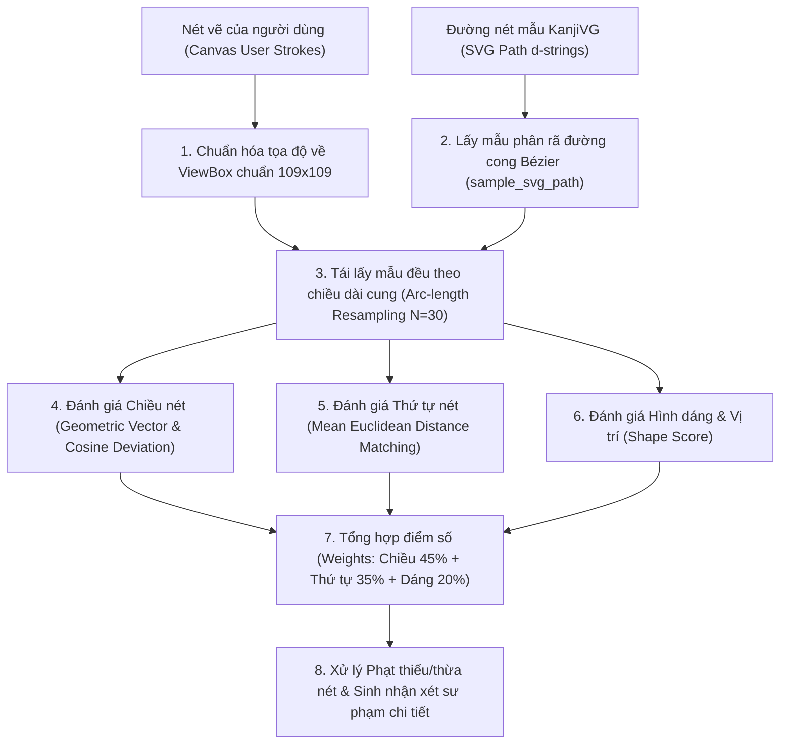

# 🈶 ElearningJP AI - Dịch vụ Trí tuệ Nhân tạo Tiếng Nhật (AI Service)

Dịch vụ AI độc lập trong hệ sinh thái **ElearningJP**, cung cấp 2 tính năng trí tuệ nhân tạo chuyên sâu phục vụ học tập tiếng Nhật:
1. **Nhận dạng chữ viết tay tự do (Freehand Kanji/Kana Recognition)**: Ứng dụng mô hình mạng nơ-ron tích chập sâu (**Deep CNN + Residual Connections**) phân loại trên **3.169 lớp ký tự**.
2. **Luyện viết & Chấm điểm thứ tự nét, chiều nét (KanjiVG Stroke Order & Direction Assessment)**: Ứng dụng thuật toán so khớp hình học vector (**Geometric Vector Matching & Arc-length Resampling**) đánh giá chính xác từng nét vẽ trên **2.355 ký tự** chuẩn KanjiVG.

---

## 🏛️ Kiến trúc tổng thể trong ElearningJP (Microservices Architecture)

```
┌─────────────────────────────────┐
│         FRONTEND (FE)           │
│      React 19 + TypeScript      │
│  - Modal Canvas Nhận dạng chữ   │
│  - Modal Luyện viết & Chấm điểm │
└─────────▲─────────────┬─────────┘
          │             │
          │ Gợi ý Top-K │ 1. Gửi nét vẽ (Base64 / Canvas Coordinates)
          │ Điểm số     │ 2. Tra cứu dữ liệu nét chuẩn KanjiVG
          │ Phản hồi    │
          │             ▼
┌─────────┴───────────────────────┐               ┌─────────────────────────┐
│         AI SERVICE (AI)         │  Dữ liệu mẫu  │      BACKEND (BE)       │
│    FastAPI + TensorFlow + Keras │<──────────────│    Spring Boot 3.3.4    │
│  - CNN Model: 3.169 Classes     │   Migration   │  - Từ điển, Khóa học    │
│  - In-Memory KanjiVG (2.355 ch) │    (Flyway)   │  - Lịch sử học tập, SRS │
└─────────────────────────────────┘               └─────────────────────────┘
```

* **Frontend (Port 5173)**: Cung cấp giao diện bảng vẽ HTML5 Canvas, xử lý sự kiện nét bút mượt mà (chuột & cảm ứng điện dung), hiển thị nét mờ dẫn đường (ghost guide) và nhận xét sư phạm thời gian thực.
* **AI Service (Port 8000)**: Chạy độc lập trên nền Python FastAPI; nạp sẵn mô hình Deep CNN và toàn bộ cơ sở dữ liệu KanjiVG vào bộ nhớ RAM (In-Memory Singleton) để phản hồi với độ trễ siêu thấp (**< 50ms**).
* **Backend Spring Boot (Port 8080)**: Quản lý cơ sở dữ liệu người dùng, tiến độ khóa học và thuật toán lặp lại ngắt quãng (Spaced Repetition System - SRS).

---

## 📊 Bộ dữ liệu & Cách thức phân chia (Datasets)

Hệ thống AI sử dụng kết hợp 2 bộ dữ liệu học máy và hình học vector quy mô lớn:

### 1. Bộ dữ liệu Huấn luyện Mô hình Nhận dạng (ETL9G + Mở rộng)
* **Nguồn dữ liệu**: **ETL9G Handwriting Dataset** do Viện Khoa học & Công nghệ Tiên tiến Quốc gia Nhật Bản (AIST) phát hành, bổ sung tập mẫu chữ Kana, chữ số và chữ cái Romaji.
* **Quy mô**: Hơn **600.000 mẫu chữ viết tay thực tế** từ hàng nghìn người viết khác nhau với độ đa dạng nét bút cao.
* **Số lượng lớp phân loại (Classes)**: **3.169 lớp** (Bao phủ 100% chữ Hán thường dùng Joyo Kanji từ JLPT N5 đến N1, Hiragana, Katakana, chữ số và ký tự Latinh).
* **Phân chia dữ liệu (Train / Validation Split)**:
  * **Tập huấn luyện (Training Set - 80%)**: ~480.000 mẫu dùng để tối ưu trọng số mạng qua gradient descent.
  * **Tập kiểm định (Validation Set - 20%)**: ~120.000 mẫu độc lập dùng để đánh giá độ chính xác, chống hiện tượng quá khớp (Overfitting).
* **Chuẩn hóa đầu vào**: Kích thước ảnh $96 \times 96$ pixel, kênh đơn (Grayscale 1 channel), giá trị điểm ảnh chuẩn hóa về $[0.0, 1.0]$.
* **Tăng cường dữ liệu (Data Augmentation)**: Áp dụng ngẫu nhiên phép xoay nhẹ ($\pm 5\%$), dịch chuyển tâm ($\pm 5\%$) và phóng to thu nhỏ ($\pm 5\%$) để mô phỏng nét vẽ lệch tự nhiên của học viên.

### 2. Bộ dữ liệu Vector Nét chuẩn Kanji (KanjiVG Database)
* **Nguồn dữ liệu**: Dự án học thuật mở **KanjiVG (Kanji Vector Graphics)** chuẩn quốc tế, trích xuất từ các bản di chuyển dữ liệu (Flyway Migrations) của ElearningJP.
* **Quy mô**: **2.355 ký tự** với **23.609 nét vẽ SVG độc lập**.
* **Phân loại cấp độ**:
  * **Kanji N5 – N1**: Đầy đủ 2.136 chữ Joyo Kanji được gán nhãn cấp độ JLPT, âm Hán Việt, nghĩa tiếng Việt, nghĩa tiếng Anh.
  * **Bảng chữ cái Kana**: Toàn bộ Hiragana và Katakana có thứ tự nét chuẩn.
* **Định dạng lưu trữ**: Tệp `AI/data/kanjivg_all.json` (~3.4 MB), được nạp trực tiếp vào RAM lúc khởi động qua [`KanjiVGService`](file:///d:/DATN/ElearningJP/AI/src/kanjivg_service.py) phục vụ truy vấn tức thì.

---

## 🧠 TÍNH NĂNG 1: Nhận dạng Chữ viết tay Kanji (Handwriting Recognition CNN)

### 1. Kiến trúc Mạng Nơ-ron (Residual Deep CNN)
Mô hình kết hợp mạng tích chập sâu và các khối kết nối tắt **Residual Connections** (tương tự ResNet) nhằm giải quyết triệt để vấn đề tiêu biến đạo hàm (Vanishing Gradient) khi phân loại trên 3.169 lớp:

```
[ Input Canvas: 96x96x1 (Ảnh nhị phân hóa nền đen nét trắng) ]
       │
       ▼
[ Conv2D(64) + BatchNorm + LeakyReLU + Conv2D(64) + MaxPool(2x2) ]  ──> Trích xuất góc, cạnh và nét cơ bản
       │
       ▼
[ Conv2D(128) + BatchNorm + LeakyReLU + Conv2D(128) + MaxPool(2x2) ] ──> Trích xuất các bộ thủ (Radicals)
       │
       ▼
[ Residual Block (256 filters) + 1x1 Conv Shortcut + MaxPool(2x2) ]  ──> Kết hợp bộ thủ và cấu trúc chữ
       │
       ▼
[ Residual Block (384 filters) + 1x1 Conv Shortcut + MaxPool(2x2) ]  ──> Trích xuất hình thái tổng thể
       │
       ▼
[ GlobalAveragePooling2D + Dense(512) + Dropout(0.3) + Dense(256) + Dropout(0.3) ]
       │
       ▼
[ Output Layer: Dense(3169, activation='softmax') ]  ──> Phân phối xác suất trên 3.169 ký tự
```

### 2. Quy trình xử lý thị giác (Vision Preprocessing Pipeline)
Khi nhận ảnh từ Canvas của người dùng (dưới dạng Base64 hoặc tệp ảnh PNG), hệ thống thực hiện 5 bước tiền xử lý nghiêm ngặt:
1. **Dynamic Background Detection & Inversion**: Tính trung bình màu 4 góc ảnh. Nếu nền sáng (> 128) thì tiến hành đảo màu âm bản (`ImageOps.invert`) để đảm bảo quy chuẩn **Nền đen nét trắng**.
2. **Bounding-box Auto-Crop**: Áp dụng ngưỡng nhị phân (Threshold = 30) tìm khung bao quanh chữ viết thực tế (`getbbox()`), cắt bỏ toàn bộ phần viền Canvas thừa.
3. **Aspect-Ratio Preserving & Centering**: Thêm khoảng đệm lề 15% (Padding) quanh chữ lớn nhất và dán vào tâm của một khung vuông mới để chống méo nét.
4. **Resampling**: Co giãn ảnh về kích thước chuẩn mô hình $96 \times 96$ pixel qua phép nội suy song tuyến (Bilinear Interpolation).
5. **Contrast Normalization**: Chuẩn hóa độ sáng cực đại về khoảng $[0.0, 1.0]$ để thích ứng với nét bút mỏng hoặc đậm.

### 3. Kết quả huấn luyện & Đánh giá
* **Top-1 Accuracy**: **99.05%** (Nhận dạng đúng ngay ở kết quả gợi ý số 1).
* **Top-5 Accuracy**: **99.93%** (Chữ mục tiêu nằm trong 5 gợi ý đầu tiên).
* **Độ trễ suy luận (Inference Latency)**: **~15ms / request** trên CPU tiêu chuẩn.

---

## ✍️ TÍNH NĂNG 2: Đánh giá Thứ tự nét & Chiều nét (KanjiVG Stroke Assessment)

Tính năng này giải quyết bài toán cốt lõi trong sư phạm tiếng Nhật: **Người học có thể vẽ ra hình dáng chữ giống mẫu nhưng vẽ sai thứ tự nét hoặc vẽ ngược chiều nét (ví dụ: kéo từ dưới lên trên thay vì từ trên xuống dưới)**.

### 1. Sơ đồ các bước thực hiện của thuật toán



---

### 2. Chi tiết các bước thuật toán (Dễ hiểu & Chi tiết toán học)

#### Bước 1: Phân rã đường cong SVG Bézier (`sample_svg_path`)
Dữ liệu chuẩn KanjiVG lưu dưới dạng đường dẫn vector SVG:
```
M23.34,27.56 c2.19,0.76,4.95,0.62,6.87,0.41 c15.78-1.72,41.52-5.94,50.19-6.72 ...
```
Thuật toán phân tích chuỗi lệnh cú pháp (`M`, `L`, `C`, `S`, `H`, `V`, `Z`):
* Với đoạn cong Bézier bậc 3 (Cubic Bézier: điểm đầu $P_0$, điểm uốn $P_1, P_2$, điểm cuối $P_3$), vị trí tại thời điểm $t \in [0, 1]$ được tính theo công thức Bernstein:
  $$B(t) = (1-t)^3 P_0 + 3(1-t)^2 t P_1 + 3(1-t) t^2 P_2 + t^3 P_3$$
* Hệ thống lấy mẫu liên tục dọc theo $t$ để biến một đường cong mềm thành chuỗi điểm tọa độ rời rạc $(x_k, y_k)$.

#### Bước 2: Chuẩn hóa kích thước khung vẽ (`normalize_user_strokes`)
Canvas người dùng có thể là $300 \times 300$, $400 \times 400$ hoặc kích thước màn hình điện thoại. Tọa độ $(x_u, y_u)$ được ánh xạ tuyến tính về hệ tọa độ chuẩn của KanjiVG ($109 \times 109$ đơn vị):
$$x_{norm} = \frac{x_u}{W_{canvas}} \times 109.0, \quad y_{norm} = \frac{y_u}{H_{canvas}} \times 109.0$$

#### Bước 3: Tái lấy mẫu đều khoảng cách nét vẽ (`Arc-length Resampling`)
* **Vấn đề**: Người dùng di chuyển chuột hoặc ngón tay với tốc độ không đều (chỗ vẽ nhanh điểm rất thưa, chỗ dừng bút điểm rất dày). Nếu so sánh trực tiếp chỉ số mảng sẽ bị sai lệch hoàn toàn.
* **Giải pháp**:
  1. Tính tổng chiều dài cung tích lũy $L$ của nét vẽ:
     $$L = \sum_{k=1}^{M-1} \sqrt{(x_{k+1}-x_k)^2 + (y_{k+1}-y_k)^2}$$
  2. Chia đều chiều dài $L$ thành $N - 1$ khoảng bằng nhau với bước nhảy $\Delta s = \frac{L}{N-1}$ (mặc định $N = 30$ điểm).
  3. Sử dụng phép nội suy tuyến tính tìm chính xác tọa độ tại từng mốc khoảng cách. Kết quả là cả nét vẽ người dùng và nét chuẩn đều được đại diện bằng đúng **30 điểm cách đều nhau**.

#### Bước 4: Đánh giá Chiều nét vẽ (`evaluate_stroke_direction`)
Để phát hiện người dùng có vẽ **ngược chiều** hay không (ví dụ nét ngang viết từ phải sang trái thay vì từ trái sang phải; nét sổ viết từ dưới lên thay vì từ trên xuống):
1. **Vector chỉ hướng tổng thể**:
   $$\vec{v}_{user} = P_{user}^{cuối} - P_{user}^{đầu}, \quad \vec{v}_{ref} = P_{ref}^{cuối} - P_{ref}^{đầu}$$
2. **Góc lệch vector giữa nét người dùng và nét chuẩn ($\theta$)**:
   $$\cos \theta = \frac{\vec{v}_{user} \cdot \vec{v}_{ref}}{\|\vec{v}_{user}\| \|\vec{v}_{ref}\|}, \quad \theta = \arccos(\cos \theta) \times \frac{180^\circ}{\pi}$$
3. **Phân loại & Điểm số chiều nét**:
   * **Đúng chiều ($\theta \le 45^\circ$)**: Điểm số từ $0.85 \rightarrow 1.0$.
   * **Hơi lệch hướng ($45^\circ < \theta \le 90^\circ$)**: Điểm số phạt giảm dần về $0.4$.
   * **Vẽ ngược chiều hoàn toàn ($\theta > 120^\circ$)**: Đánh dấu cờ `is_reversed = True`, điểm chiều nét bị phạt nặng ($\le 0.15$), sinh lời nhắc cụ thể: *"Vẽ ngược chiều! Cần vẽ từ trái sang phải (lệch 175°)"*.

#### Bước 5: Đánh giá Thứ tự nét vẽ (`Stroke Order Matching`)
Để kiểm tra xem người dùng vẽ có đúng thứ tự không (hay vẽ nét số 3 trước nét số 1):
1. Với nét vẽ thứ $i$ của người dùng, thuật toán tính khoảng cách hình học trung bình (Mean Euclidean Distance) với **tất cả** các nét chuẩn $k \in \{1 \dots M\}$ của ký tự:
   $$D(User_i, Ref_k) = \frac{1}{30} \sum_{j=1}^{30} \sqrt{(x_{u,j} - x_{r_k,j})^2 + (y_{u,j} - y_{r_k,j})^2}$$
2. Tìm nét chuẩn có khoảng cách nhỏ nhất $k^* = \arg\min_k D(User_i, Ref_k)$:
   * Nếu $k^* = i$: Nét vẽ **đúng thứ tự** (`order_correct = True`).
   * Nếu $k^* \ne i$: Người dùng đã **viết sai thứ tự nét** (`order_correct = False`), hệ thống phản hồi chính xác: *"Sai thứ tự nét: Nét bạn vừa vẽ giống nét số $k^*+1$ hơn là nét số $i+1$"*.

#### Bước 6: Tổng hợp Điểm số & Xử lý số lượng nét
1. **Điểm từng nét**:
   $$\text{Score}_{stroke} = (0.45 \times \text{Score}_{hướng} + 0.35 \times \text{Weight}_{thứ\_tự} + 0.20 \times \text{Score}_{dáng}) \times 100$$
2. **Xử lý thiếu / thừa nét**:
   * Nếu số nét vẽ $N_{nhận} \ne N_{chuẩn}$, hệ thống áp dụng điểm phạt tỷ lệ:
     $$\text{Penalty} = |N_{nhận} - N_{chuẩn}| \times 15.0$$
   * Điểm tổng thể: $\text{OverallScore} = \max(0.0, \text{Score}_{trung\_bình} - \text{Penalty})$.
3. **Điều kiện đạt bài thi hoàn hảo (is_all_correct = True)**:
   * Số lượng nét tuyệt đối chính xác ($N_{nhận} = N_{chuẩn}$).
   * 100% các nét đều đúng thứ tự và đúng chiều vẽ.
   * Điểm tổng thể đạt từ **80.0 điểm trở lên**.

---

## 📡 Danh sách API Endpoints chi tiết

Tất cả các API được bảo vệ bởi CORS cho phép giao tiếp trực tiếp với Frontend.

| Phương thức | Đường dẫn API | Nhóm chức năng | Mô tả chi tiết |
| :--- | :--- | :--- | :--- |
| `GET` | `/health` hoặc `/api/v1/health` | **Health** | Kiểm tra trạng thái AI Service và số lượng lớp nhận dạng đang tải (3.169 lớp). |
| `POST` | `/api/v1/predict` | **Recognition** | Nhận diện chữ viết tay từ FormData ảnh (PNG/JPEG) gửi lên từ Canvas. |
| `POST` | `/api/v1/predict-base64` | **Recognition** | Nhận diện chữ viết tay trực tiếp từ chuỗi Base64 DataURL (`canvas.toDataURL()`). |
| `POST` | `/api/v1/evaluate-strokes` | **Assessment** | Chấm điểm thứ tự nét và chiều nét viết Kanji/Kana (Tự động fallback tìm kiếm nét chuẩn nếu client không truyền `reference_strokes`). |
| `GET` | `/api/v1/kanji-strokes/{char}` | **Kanji Data** | Lấy toàn bộ danh sách nét SVG chuẩn và từ điển của một ký tự trong 2.355 chữ. |
| `GET` | `/api/v1/kanji-list` | **Kanji Data** | Lấy danh sách ký tự mẫu có lọc theo cấp độ JLPT (`N5`, `N4`, `N3`, `N2`, `N1`, `KANA`). |

### Ví dụ dữ liệu chấm điểm nét vẽ (`POST /api/v1/evaluate-strokes`):
```json
{
  "success": true,
  "character": "二",
  "total_strokes_expected": 2,
  "total_strokes_received": 2,
  "is_stroke_count_correct": true,
  "is_all_correct": true,
  "overall_score": 96.5,
  "feedback": "Xuất sắc! Bạn đã viết chữ '二' đúng chuẩn 100% về cả số nét, thứ tự và chiều nét.",
  "stroke_details": [
    {
      "stroke_number": 1,
      "user_stroke_index": 0,
      "order_correct": true,
      "direction_score": 0.98,
      "is_direction_correct": true,
      "is_reversed": false,
      "shape_score": 0.94,
      "feedback": "Đúng thứ tự nét 1. Đúng chiều nét (từ trái sang phải)."
    },
    {
      "stroke_number": 2,
      "user_stroke_index": 1,
      "order_correct": true,
      "direction_score": 0.97,
      "is_direction_correct": true,
      "is_reversed": false,
      "shape_score": 0.96,
      "feedback": "Đúng thứ tự nét 2. Đúng chiều nét (từ trái sang phải)."
    }
  ]
}
```

---

## 🛠️ Hướng dẫn Khởi chạy Dịch vụ AI (Local Development)

### 1. Chuẩn bị môi trường Python (Python 3.10+)
```bash
cd AI
python -m venv venv

# Windows PowerShell:
.\venv\Scripts\Activate.ps1

# Linux / macOS:
source venv/bin/activate
```

### 2. Cài đặt các thư viện phụ thuộc
```bash
pip install -r requirements.txt
```

### 3. Chạy toàn bộ Unit Test tự động
```bash
python -m unittest discover -s tests -p "test_*.py"
```
*(Kết quả kỳ vọng: 10/10 test cases passed thành công trong < 0.05 giây)*.

### 4. Khởi động máy chủ AI Service
```bash
uvicorn src.main:app --host 0.0.0.0 --port 8000 --reload
```
* **Swagger UI tương tác (API Docs)**: [http://localhost:8000/docs](http://localhost:8000/docs)
* **ReDoc Documentation**: [http://localhost:8000/redoc](http://localhost:8000/redoc)
