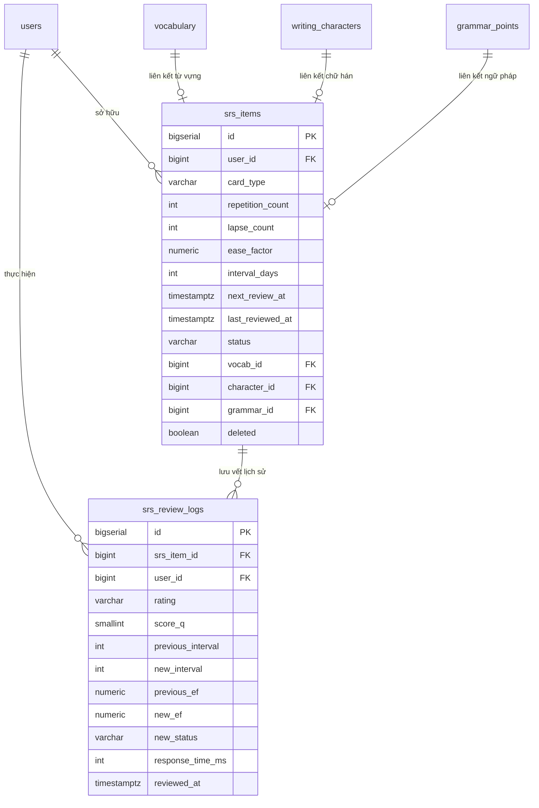

# 🧠 Hệ thống Lặp lại Ngắt quãng (Spaced Repetition System - SRS)

Tài liệu thiết kế kiến trúc, cấu trúc cơ sở dữ liệu, thuật toán toán học và cơ chế vận hành của phân hệ **SRS (Spaced Repetition System)** trong nền tảng học tiếng Nhật **ElearningJP**.

---

## 📑 Mục lục
1. [Tổng quan nghiệp vụ](#1-tổng-quan-nghiệp-vụ)
2. [Cấu trúc Cơ sở dữ liệu (Database Schema)](#2-cấu-trúc-cơ-sở-dữ-liệu-database-schema)
3. [Thuật toán cốt lõi: SuperMemo-2 (SM-2)](#3-thuật-toán-cốt-lõi-supermemo-2-sm-2)
4. [3 Con đường nạp dữ liệu vào SRS (Ingestion Pathways)](#4-3-con-đường-nạp-dữ-liệu-vào-srs-ingestion-pathways)
5. [Cơ chế Đánh giá: Hệ thống tự động (Quiz) vs Người dùng tự đánh giá (Flashcard)](#5-cơ-chế-đánh-giá-hệ-thống-tự-động-quiz-vs-người-dùng-tự-đánh-giá-flashcard)
6. [Hàng đợi ôn tập & Giải quyết các tình huống thực tế (Edge Cases)](#6-hàng-đợi-ôn-tập--giải-quyết-các-tình-huống-thực-tế-edge-cases)
7. [Danh sách API Endpoints (Backend SrsController)](#7-danh-sách-api-endpoints-backend-srscontroller)
8. [Hiện trạng triển khai trên Hệ thống (BE vs FE)](#8-hiện-trạng-triển-khai-trên-hệ-thống-be-vs-fe)

---

## 1. Tổng quan nghiệp vụ

Phân hệ SRS trong **ElearningJP** được xây dựng nhằm giải quyết bài toán cốt lõi của người học ngoại ngữ: **chống lại đường cong quên lãng (Ebbinghaus Forgetting Curve)**.
* Thay vì học dồn dập rồi quên sau vài ngày, SRS tự động tính toán thời điểm học viên **sắp sửa quên** một chữ Hán, từ vựng hoặc điểm ngữ pháp để đưa ra nhắc nhở ôn tập đúng lúc.
* Giao diện ôn tập tương tác dưới dạng **Flashcard lật thẻ**:
  * **Mặt trước (Front)**: Chữ Kanji, từ vựng Hiragana/Katakana hoặc mẫu ngữ pháp.
  * **Mặt sau (Back)**: Nghĩa tiếng Việt, âm Hán Việt, cách đọc Furigana/Onyomi/Kunyomi, ví dụ song ngữ và âm thanh phát âm chuẩn (`audioUrl`).

---

## 2. Cấu trúc Cơ sở dữ liệu (Database Schema)

SRS được lưu trữ trong PostgreSQL thông qua **2 bảng chính** được tối ưu hóa chỉ mục cho hàng triệu lượt ôn tập:



### 2.1. Bảng `srs_items` (Trạng thái thẻ hiện tại của từng học viên)
Mỗi thẻ học đại diện cho một thực thể kiến thức của riêng người dùng:
* `user_id`: Khóa ngoại liên kết tới bảng `users`.
* **Khóa liên kết nội dung (Polymorphic Target)**:
  * `vocab_id`: Khóa ngoại tới `vocabulary` (Từ vựng).
  * `character_id`: Khóa ngoại tới `writing_characters` (Chữ Hán).
  * `grammar_id`: Khóa ngoại tới `grammar_points` (Ngữ pháp).
  > **Chống trùng lặp tuyệt đối (Partial Unique Index)**:
  > - `uq_srs_items_user_vocab` ON `(user_id, vocab_id) WHERE deleted = FALSE`
  > - `uq_srs_items_user_character` ON `(user_id, character_id) WHERE deleted = FALSE`
  > - `uq_srs_items_user_grammar` ON `(user_id, grammar_id) WHERE deleted = FALSE`
* **Các chỉ số thuật toán SM-2**:
  * `ease_factor` (NUMERIC 3,2): Hệ số ghi nhớ cá nhân (mặc định `2.50`, khoảng hợp lệ `[1.30, 3.50]`).
  * `interval_days` (INT): Khoảng cách số ngày cho lần ôn tập kế tiếp (0, 1, 6, 15, 30 ngày...).
  * `repetition_count` (INT): Số lần nhớ đúng liên tiếp (reset về 0 nếu chọn `AGAIN`).
  * `lapse_count` (INT): Tổng số lần bị quên thẻ này trong quá khứ.
* **Thời gian & Trạng thái**:
  * `next_review_at` (TIMESTAMPTZ): Mốc thời gian chính xác thẻ đến hạn ôn.
  * `last_reviewed_at` (TIMESTAMPTZ): Thời điểm ôn gần nhất.
  * `status`: Trạng thái thẻ (`LEARNING`, `REVIEWING`, `MASTERED`).
  * `deleted`: Cờ xóa mềm (Soft Delete).
  > **Chỉ mục truy vấn tốc độ cao**:
  > `idx_srs_items_user_due` ON `(user_id, next_review_at) WHERE deleted = FALSE`.

### 2.2. Bảng `srs_review_logs` (Nhật ký lịch sử ôn tập bất biến)
Ghi nhận toàn bộ tiến trình học tập để phục vụ thống kê, vẽ biểu đồ quên lãng và phân tích hành vi:
* `rating`: Đánh giá chất lượng (`AGAIN`, `HARD`, `GOOD`, `EASY`).
* `score_q`: Điểm chất lượng SM-2 (từ 1 đến 5).
* `previous_interval` $\rightarrow$ `new_interval`: Chu kỳ ngày trước và sau khi ôn.
* `previous_ef` $\rightarrow$ `new_ef`: Hệ số EF trước và sau khi ôn.
* `response_time_ms`: Thời gian người học suy nghĩ trước khi trả lời (ms).
* `reviewed_at`: Thời điểm chính xác thực hiện hành động.

---

## 3. Thuật toán cốt lõi: SuperMemo-2 (SM-2)

Thuật toán được triển khai tại file: `Sm2Algorithm.java`.

### 3.1. Bốn mức độ ghi nhớ (SrsRating)
| Rating | Điểm chất lượng $q$ | Mô tả ý nghĩa sư phạm |
| :--- | :---: | :--- |
| **AGAIN** | **1** | Quên hoàn toàn, lật thẻ mới nhớ ra $\rightarrow$ Cần học lại ngay. |
| **HARD** | **3** | Nhớ được nhưng mất nhiều thời gian, đắn đo suy nghĩ. |
| **GOOD** | **4** | Nhớ bình thường, phản xạ đúng chuẩn mực. |
| **EASY** | **5** | Quá dễ, từ đã khắc sâu vào phản xạ tự nhiên. |

### 3.2. Công thức toán học cập nhật

#### A. Cập nhật hệ số ghi nhớ ($EF$ - Ease Factor)
* Khi học viên chọn **AGAIN**:
  $$EF_{mới} = EF_{cũ} - 0.20$$
* Khi học viên chọn **HARD**, **GOOD**, hoặc **EASY** (Áp dụng công thức chuẩn SM-2):
  $$EF_{mới} = EF_{cũ} + \left(0.1 - (5 - q) \times (0.08 + (5 - q) \times 0.02)\right)$$
* *Ràng buộc biên độ*: Luôn kẹp $EF$ trong khoảng $[1.30, 3.50]$:
  $$EF_{mới} = \min(3.50, \max(1.30, EF_{mới}))$$

#### B. Cập nhật chu kỳ ôn tập ($Interval$)
* **Nếu chọn AGAIN**:
  * Reset $repetition\_count = 0$.
  * Tăng $lapse\_count = lapse\_count + 1$.
  * Chu kỳ reset: $Interval_{mới} = 1$ ngày.
  * Trạng thái: `status = LEARNING`.

* **Nếu chọn GOOD**:
  * Lần 1 đúng ($n = 1$): $Interval = 1$ ngày.
  * Lần 2 đúng ($n = 2$): $Interval = 6$ ngày.
  * Lần $n \ge 3$ đúng: $Interval_{mới} = \text{round}(Interval_{cũ} \times EF)$.
  * Trạng thái: `status = REVIEWING`.

* **Nếu chọn HARD**:
  * Chu kỳ tăng chậm hơn bình thường:
    $$Interval_{mới} = \max(1, \text{round}(\max(1, Interval_{cũ}) \times 1.2))$$

* **Nếu chọn EASY**:
  * Chu kỳ tăng tốc vượt bậc:
    * Lần 1 đúng: $Interval = 3$ ngày.
    * Lần 2 đúng: $Interval = 8$ ngày.
    * Lần $n \ge 3$: $Interval_{mới} = \text{round}(Interval_{cũ} \times EF \times 1.3)$.

#### C. Tính thời điểm ôn tập tiếp theo (`nextReviewAt`)
$$nextReviewAt = Instant.now() + Interval_{mới}\ (\text{ngày})$$

#### D. Điều kiện đạt mức Thành thạo (`MASTERED`)
Một thẻ được tự động công nhận là **Thành thạo (Mastered)** khi:
$$Interval_{mới} \ge 30\ \text{ngày} \quad \text{và} \quad repetition\_count \ge 4$$

---

## 4. 3 Con đường nạp dữ liệu vào SRS (Ingestion Pathways)

```
       [ 1. Tra cứu Từ điển ] ──> POST /api/v1/srs/items ─────────┐
                                                                  │
      [ 2. Hoàn thành Bài học ] ──> POST /lessons/{id}/batch-add ──┼──> [ Bảng srs_items ]
                                                                  │
[ 3. Nộp bài Quiz kiểm tra ] ──> syncQuestionResultToSrs ─────────┘
```

1. **Thêm thủ công từ Từ điển (`POST /api/v1/srs/items`)**:
   Khi tra cứu Kanji, Từ vựng, Ngữ pháp, học viên bấm *"Lưu SRS"*.
2. **Thêm hàng loạt từ Bài học (`POST /api/v1/srs/lessons/{id}/batch-add`)**:
   Hệ thống tự động duyệt qua tất cả các `LessonSection` (Kanji, Từ vựng, Ngữ pháp) trong bài học và thêm toàn bộ vào danh sách ôn tập chỉ với 1 click.
3. **Tự động đồng bộ từ Bài kiểm tra (`QuizService -> syncQuestionResultToSrs`)**:
   Khi học viên làm Quiz kiểm tra bài học, hệ thống tự động cập nhật hoặc thêm mới vào SRS dựa trên kết quả làm bài.

---

## 5. Cơ chế Đánh giá: Hệ thống tự động (Quiz) vs Người dùng tự đánh giá (Flashcard)

Hệ thống hỗ trợ song song 2 cơ chế đánh giá tùy theo ngữ cảnh học tập:

| Tiêu chí | Chế độ 1: Làm Bài kiểm tra Quiz | Chế độ 2: Ôn tập Flashcard chuyên dụng |
| :--- | :--- | :--- |
| **Đối tượng đánh giá** | **Hệ thống AI/Backend TỰ ĐỘNG 100%** | **Học viên TỰ ĐÁNH GIÁ** |
| **Hành vi người dùng** | Chỉ làm bài trắc nghiệm / điền từ / nối cặp | Lật xem mặt trước $\rightarrow$ mặt sau |
| **Tương tác nút bấm** | Không có nút Again/Hard/Good/Easy | Bấm 1 trong 4 nút: Again / Hard / Good / Easy |
| **Căn cứ xác định Rating** | **Tính Đúng/Sai** + **Thời gian phản xạ (`responseTimeMs`)** | Cảm nhận mức độ thuộc bài của người học |

### Chi tiết logic chấm điểm tự động từ Quiz (`QuizService.java`):

#### 1. Điều kiện tiên quyết:
Câu hỏi Quiz bắt buộc phải gắn với 1 Từ vựng (`vocab_id`) hoặc 1 Chữ Hán (`character_id`). Các câu hỏi ngữ pháp hoặc lý thuyết chung sẽ được bỏ qua.

#### 2. Đối với câu hỏi Trắc nghiệm & Điền từ:
* Chọn **SAI** $\rightarrow$ Hệ thống tự động gán: **`AGAIN`**.
* Chọn **ĐÚNG**:
  * Phản xạ cực nhanh ($< 3$ giây $\rightarrow < 3000$ ms): **`EASY`** (Kiến thức đã thành phản xạ).
  * Suy nghĩ quá lâu ($> 15$ giây $\rightarrow > 15000$ ms): **`HARD`** (Còn đắn đo, lúng túng).
  * Trong khoảng bình thường ($3 - 15$ giây): **`GOOD`** (Nhớ chuẩn).

#### 3. Đối với câu hỏi Ghép cặp (MATCHING):
* Nối đúng $< 60\%$ số cặp: **`AGAIN`**.
* Nối đúng từ $60\% \rightarrow < 100\%$: **`HARD`**.
* Nối đúng $100\%$ trong vòng $< 10$ giây: **`EASY`**.
* Nối đúng $100\%$ nhưng mất $> 30$ giây: **`HARD`**.
* Nối đúng $100\%$ trong khoảng $10 - 30$ giây: **`GOOD`**.

---

## 6. Hàng đợi ôn tập & Giải quyết các tình huống thực tế (Edge Cases)

### ❓ Tình huống 1: Giả sử có 100 thẻ có cùng độ khó và cùng hạn ôn, hệ thống lấy ra cho học viên ôn như thế nào?
1. **Câu lệnh truy vấn Backend (`SrsItemRepository.java`)**:
   ```sql
   SELECT s FROM srs_items s
   WHERE s.user_id = :userId 
     AND s.next_review_at <= :now 
     AND s.deleted = FALSE
   ORDER BY s.next_review_at ASC
   ```
2. **Phân trang an toàn**: Mặc định hệ thống lấy ra gói **20 thẻ đầu tiên** (`limit = 20`, tối đa 100 thẻ).
3. **Cơ chế trượt hàng đợi (Sliding Queue)**:
   * Khi học viên ôn xong thẻ số 1 và gửi đánh giá $\rightarrow$ Thẻ số 1 được cập nhật `nextReviewAt = now + interval` (chuyển sang ngày mai hoặc tuần sau).
   * Thẻ số 1 không còn thỏa mãn điều kiện `nextReviewAt <= now` $\rightarrow$ Biến mất khỏi hàng đợi hiện tại.
   * **Thẻ số 21 sẽ tự động trượt lên thế chỗ**. Học viên có thể liên tục ôn tập hết 100 thẻ mà không lo bị nghẽn hay trùng lặp.

---

### ❓ Tình huống 2: Nếu có 20 thẻ cần ôn vào ngày mai nhưng mai học viên không vào hệ thống thì các thẻ đó sẽ thế nào? Đã có trong code chưa?
* **Thực tế xảy ra**:
  * Giả sử 20 thẻ có hạn ôn là `08:00 ngày 18/10`.
  * Ngày 18/10 học viên không vào học. Đến ngày 19/10 học viên mới đăng nhập.
  * Lúc này, thời điểm hiện tại `now` là ngày 19/10.
  * Biểu thức kiểm tra:
    $$\text{nextReviewAt (ngày 18)} \le \text{now (ngày 19)} \implies \mathbf{TRUE}$$
* **Hành vi hệ thống**:
  1. **Thẻ KHÔNG bị mất hay bị phạt**: Thẻ vẫn nằm nguyên vẹn trong DB, không bị trừ điểm khi học viên offline.
  2. **Thẻ chuyển sang trạng thái "Quá hạn" (Overdue)**: Do sắp xếp theo `ORDER BY next_review_at ASC`, các thẻ bị quá hạn này sẽ có timestamp nhỏ nhất nên **được ưu tiên ghim ngay lên đầu danh sách** để học viên học bù trước.
  3. **Thời điểm tính chu kỳ mới**: Khi học viên bấm học bù, chu kỳ mới được tính cộng dồn từ **thời điểm thực tế bấm học bù** (`Instant.now() + newInterval`).
* **Đã có trong code chưa?**:
  * **👉 ĐÃ CÓ 100% TRONG CODE HIỆN TẠI** tại `SrsItemRepository.java` (dòng 23-25) và `Sm2Algorithm.java` (dòng 121).

---

## 7. Danh sách API Endpoints (Backend SrsController)

| Phương thức | Endpoint API | Quyền hạn | Mô tả chức năng |
| :--- | :--- | :---: | :--- |
| `GET` | `/api/v1/srs/due?limit=20` | Học viên | Lấy danh sách hàng đợi các thẻ đến hạn ôn tập hôm nay. |
| `POST` | `/api/v1/srs/items` | Học viên | Thêm lẻ 1 từ vựng/chữ Hán/ngữ pháp vào sổ tay cá nhân. |
| `POST` | `/api/v1/srs/lessons/{lessonId}/batch-add` | Học viên | Quét tự động và thêm toàn bộ kiến thức trong bài học vào SRS. |
| `POST` | `/api/v1/srs/batch` | Học viên | Thêm hàng loạt theo danh sách ID truyền lên. |
| `POST` | `/api/v1/srs/items/{id}/review` | Học viên | Nộp kết quả lật thẻ (Again, Hard, Good, Easy) để cập nhật SM-2. |
| `GET` | `/api/v1/srs/stats` | Học viên | Xem thống kê số lượng thẻ (Due today, Learning, Reviewing, Mastered). |

---

## 8. Hiện trạng triển khai trên Hệ thống (BE vs FE)

* ✅ **Backend (BE)**: Đã hoàn thiện **100%**:
  * Đầy đủ Entity, Migration bảng và composite index tối ưu.
  * Cài đặt chuẩn thuật toán SM-2, hệ thống điểm thưởng kinh nghiệm (XP).
  * Đầy đủ 6 API endpoints trong `SrsController`.
  * Tích hợp đồng bộ tự động từ Quiz sang SRS trong `QuizService`.

* 🔄 **Frontend (FE)**:
  * **Đã triển khai**: Nút "Lưu SRS" / "Đã lưu SRS" ở trang Từ điển (`DictionaryPage`) cho cả Từ vựng (`VocabCard`), Chữ Hán (`KanjiDetailModal`) và Ngữ pháp (`GrammarCard`).
  * **Đang chờ phát triển (Backlog)**:
    1. Màn hình Ôn tập Flashcard chuyên dụng (`/srs/review`): Lật thẻ tương tác 3D và 4 nút chọn `Again`, `Hard`, `Good`, `Easy`.
    2. Widget Dashboard hiển thị số thẻ cần ôn hôm nay trên Trang chủ.
    3. Nút bấm "Lưu bài học vào SRS" trên trang chi tiết Bài học.
