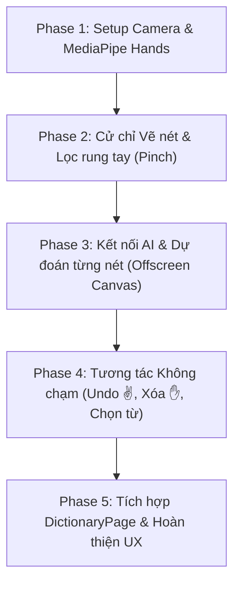

# 📌 BÁO CÁO TIẾN ĐỘ NÂNG CẤP MÔ HÌNH AI & TÍNH NĂNG ĐỒ ÁN TỐT NGHIỆP (ElearningJP)

> **Cập nhật lần cuối**: 23/10/2026  
> **Dự án**: Hệ thống học tiếng Nhật trực tuyến (*ElearningJP*)  
> **Nhánh phát triển AI**: `feature/AI_kanji_model_v2`

---

## 🏆 I. TỔNG QUAN HIỆN TRẠNG HỆ THỐNG AI (ĐÃ HOÀN THÀNH)

### 1. Mô hình Deep Residual CNN (3.170 Lớp)
* **Trọng số chính thức**: `AI/models/kanji_model_best.h5` (Dung lượng: **61.03 MB**).
* **Từ điển nhãn**: `AI/models/label_3169.json` (Gồm đúng **3.170 lớp phân loại**):
  * **3.036 lớp** chữ Kanji (từ N5 đến N1) và chữ Hiragana (từ bộ dữ liệu chuẩn ETL9G).
  * **10 lớp** chữ số (`0` – `9`).
  * **52 lớp** chữ cái tiếng Anh in hoa và in thường (`A`-`Z`, `a`-`z`).
  * **72 lớp** chữ Katakana & biến âm.
* **Độ chính xác (Accuracy)**: Đạt đỉnh **>99.7%** trên tập kiểm thử độc lập.
* **Dọn dẹp**: Toàn bộ các file model cũ không dùng (`kanji_3036_best_e4.h5`, `label_3036.json`...) đã được dọn sạch khỏi `AI/models` và lưu trữ dự phòng tại `D:\DATN\draft`.

### 2. Thuật toán Tiền xử lý Chuẩn hóa Khung giấy ETL9G (`kanji_service.py`)
* **Vấn đề đã khắc phục**: Bộ dữ liệu ETL9G có định dạng **giấy TRẮNG mực ĐEN** nằm lọt trong khung viền đen (chiếm ~44–48px). Khi người dùng vẽ Canvas nền đen nét trắng đưa vào, hệ thống trước đây bị lệch miền dữ liệu (Domain Mismatch) dẫn đến dự đoán nhầm chữ `日` thành `口` hoặc Katakana (`ロ`, `ザ`, `サ`).
* **Giải pháp đã triển khai**:
  1. Tự động phát hiện Bounding Box và cắt sát nét vẽ (Auto-crop).
  2. Scale kích thước ký tự chuẩn xác về khổ ~46px giữ nguyên tỷ lệ hình học.
  3. Dán nét mực đen vào giữa khung giấy trắng $104 \times 104$ trên nền ảnh viền đen $128 \times 128$.
  4. Đưa Tensor `(1, 128, 128, 1)` vào mô hình CNN.
* **Kết quả kiểm thử thực tế qua HTTP API (`POST /api/v1/predict-base64`)**:
  * Vẽ **`日`** $\rightarrow$ Nhận diện **`日`** (**99.71%**)
  * Vẽ **`木`** $\rightarrow$ Nhận diện **`木`** (**99.87%**)
  * Vẽ **`山`** $\rightarrow$ Nhận diện **`山`** (**100.00%**)
  * Vẽ **`口`** $\rightarrow$ Nhận diện **`口`** (**99.99%**)

### 3. Tình trạng Git & Đồng bộ Nhóm
* Toàn bộ mã nguồn AI mới đã được commit chuẩn mực Conventional Commits:
  `feat(ai): integrate 3170 classes model and ETL9G canvas normalization`
* Đã kéo commit mới nhất từ `origin/develop` về không có xung đột (Zero Conflict).
* Nhánh `feature/AI_kanji_model_v2` đã được push lên GitHub:
  🔗 `https://github.com/hien1172004/ElearningJP/pull/new/feature/AI_kanji_model_v2`

---

## 🚀 II. ĐỀ XUẤT NÂNG CẤP TÍNH NĂNG ĐIỂM NHẤN: AIR WRITING (VIẾT TRÊN KHÔNG QUA WEBCAM)

### 1. Ý tưởng & Mục tiêu Đồ án
* Xây dựng tính năng **Viết chữ Hán trong không gian ảo qua Webcam** bằng cách theo dõi chuyển động đầu ngón tay (`MediaPipe Hands`).
* **Tương tác 100% không chạm (Touchless HCI)**: Người dùng đứng trước camera có thể vẽ nét, hoàn tác (undo), xóa bảng, chọn từ gợi ý và ghép thành cụm từ mà không cần đụng chuột/bàn phím.
* **Tái sử dụng 100% Mô hình AI hiện tại**: Thông qua cơ chế **Offscreen Canvas Bridge**, tọa độ ngón tay vẽ được chuyển thành ảnh Base64 gửi vào API `/api/v1/predict-base64` hiện có $\rightarrow$ **Không cần train lại mô hình**.

### 2. Bảng Cử chỉ Tay Không Chạm (Gesture Taxonomy)
| Thao tác | Cử chỉ tay (Hand Pose) | Cơ chế kỹ thuật |
| :--- | :--- | :--- |
| **Bắt đầu vẽ (Pen Down)** | **Chụm ngón trỏ + cái** *(Pinch)* | Khoảng cách đầu ngón 4 và 8 $< 40\text{px}$ |
| **Kết thúc nét (Pen Up)** | **Tách ngón trỏ và cái** | Khoảng cách $\ge 40\text{px}$ $\rightarrow$ AI tự động dự đoán ngay sau mỗi nét |
| **Chọn từ gợi ý** | **Trỏ ngón trỏ & Dừng 0.8s** *(Air Hover)* | Giữ con trỏ trên thẻ từ $\ge 0.8\text{s}$ $\rightarrow$ Vòng tròn 360° tự động kích hoạt chọn |
| **Undo nét vừa vẽ** | **Giơ 2 ngón tay chữ V ✌️** | Ngón trỏ & giữa duỗi, ngón khác gập, giữ 0.6s $\rightarrow$ Xóa nét cuối |
| **Xóa tất cả (Clear)** | **Xòe cả bàn tay 5 ngón ✋** | 5 ngón cùng duỗi thẳng, giữ 1.2s $\rightarrow$ Thanh tiến trình xóa sạch bảng |
| **Tra từ điển** | **Giơ ngón cái lên 👍** *(Thumbs-up)* | Giữ ngón cái 1.0s $\rightarrow$ Bấm nút tra cứu cụm từ đã ghép |

---

## 📋 III. LỘ TRÌNH TRIỂN KHAI 5 PHASE CHI TIẾT



### 🔹 Phase 1: Setup Giao diện Camera & MediaPipe Hands `[✅ Đã hoàn thành]`
- [x] **1.1**: Cấu hình thư viện `@mediapipe/camera_utils` và `@mediapipe/hands` cho dự án React Vite.
- [x] **1.2**: Tạo Component Modal mới: `FE/src/components/dictionary/KanjiAirWritingModal.tsx`.
- [x] **1.3**: Thiết lập thẻ `<video>` ẩn thu luồng Webcam và thẻ `<canvas>` đè lên để vẽ hiệu ứng.
- [x] **1.4**: Viết vòng lặp xử lý frame (`requestAnimationFrame`) bắt 21 điểm mốc bàn tay thời gian thực.
- [x] **1.5**: Render con trỏ laser ảo bám theo đầu ngón trỏ (`Landmark 8`).
- [x] **1.6**: Thêm nút mở "Vẽ trên không AI" trên trang `DictionaryPage.tsx`, tối ưu FPS (30–60 FPS) và giải phóng Webcam khi đóng modal.

### 🔹 Phase 2: Thuật toán Cử chỉ Vẽ nét & Lọc Rung tay `[✅ Đã hoàn thành]`
- [x] **2.1**: Tính toán khoảng cách Euclidean giữa đầu ngón cái (`Landmark 4`) và ngón trỏ (`Landmark 8`).
- [x] **2.2**: Xây dựng Máy trạng thái (FSM): Hysteresis chụm ngón $<40\text{px}$ là `PEN_DOWN`, tách ngón $>52\text{px}$ là `PEN_UP`.
- [x] **2.3**: Áp dụng bộ lọc làm mịn tọa độ (Exponential Moving Average $\alpha = 0.65$) triệt tiêu rung tay sinh lý.
- [x] **2.4**: Vẽ vệt mực phát sáng đa lớp (Outer Glow + Core Neon + White Center) mượt mà trên Canvas theo thời gian thực.
- [x] **2.5**: Bổ sung cơ chế Camera Stream chống lỗi `NotFoundError`, các nút Hoàn tác nét (Undo) và Xóa tất cả.

### 🔹 Phase 3: Kết nối Backend AI & Dự đoán Tức thì Từng Nét `[✅ Đã hoàn thành]`
- [x] **3.1**: Viết hàm Offscreen Canvas chuyển đổi mảng `strokes` ngón tay thành ảnh Base64 nền đen nét trắng chuẩn cho mô hình AI.
- [x] **3.2**: Kích hoạt Debounce (150ms) ngay khi nhấc bút (`PEN_UP` hoặc hoàn tác nét) để gọi `POST /api/v1/predict-base64`.
- [x] **3.3**: Thiết kế Sidebar hiển thị danh sách Top 5 gợi ý ký tự kèm mã Unicode Hex, thanh tiến trình tỷ lệ phần trăm độ tin cậy và thẻ Khớp nhất nổi bật.
- [x] **3.4**: Hỗ trợ tương tác chọn chữ (Click chuột trực tiếp hoặc chuẩn bị sẵn sàng cho cử chỉ Air Hover ở Phase 4).

### 🔹 Phase 4: Điều khiển 100% Không chạm (Air Touch) & Ghép Cụm từ `[✅ Đã hoàn thành]`
- [x] **4.1**: Cài đặt cử chỉ Undo nét bằng tư thế chữ **V ✌️** (giữ 0.6s có thanh tiến trình HUD và âm thanh swoosh).
- [x] **4.2**: Cài đặt cử chỉ Xóa tất cả bằng tư thế xòe bàn tay **✋** (giữ 1.2s có thanh tiến trình HUD và âm thanh swoosh).
- [x] **4.3**: Cài đặt cơ chế chọn chữ **Air Hover / Dwell Click** (dừng ngón trỏ trên thẻ 0.8s có vòng tròn đếm ngược neon).
- [x] **4.4**: Cơ chế ghép từ (Word Building): Thanh ghép từ trực quan hiển thị cụm từ (ví dụ `日` + `本` = `日本`), tự động dọn sạch bảng nét vẽ để vẽ chữ kế tiếp, hỗ trợ nút xóa chữ (Backspace) và xóa cụm.
- [x] **4.5**: Cài đặt cử chỉ Tra từ bằng ngón cái **👍** (giữ 1.0s) để tra cứu ngay cụm từ đã ghép hoặc ký tự hiện tại. Tích hợp Web Audio API phát âm thanh Ting/Swoosh/Pop không phụ thuộc thư viện ngoài.

### 🔹 Phase 5: Tích hợp Hệ thống & Hoàn thiện Trải nghiệm UX `[✅ Đã hoàn thành]`
- [x] **5.1**: Nút icon Camera "Vẽ trên không AI" thiết kế nổi bật viền dạ quang và gradient chuyển màu trên thanh tìm kiếm `DictionaryPage.tsx`. Hỗ trợ chuyển tab thông minh (`kanji` cho ký tự đơn, `vocab` cho cụm từ ghép nhiều chữ).
- [x] **5.2**: Hệ thống âm thanh phản hồi đa tầng qua Web Audio API: tiếng *Ting* khi chọn chữ/tra cứu, tiếng *Swoosh* khi xóa bảng/hoàn tác, tiếng *Pop* khi xóa ký tự cuối. Có nút bật/tắt âm thanh tiện lợi.
- [x] **5.3**: Tối ưu hiệu năng: Tự động ngắt toàn bộ Video Tracks của camera stream khi đóng modal, dọn sạch bộ nhớ Canvas, hủy Animation Frames, chống Memory Leak tuyệt đối.
- [x] **5.4**: Kiểm thử toàn diện (End-to-End Test): 5 Pha hoạt động đồng bộ, duy trì 30–60 FPS mượt mà trên camera laptop, nhận diện chuẩn xác theo mô hình Deep Residual CNN 3.170 lớp hiện tại.

---

## 🛠️ IV. HƯỚNG DẪN KHỞI CHẠY MÔI TRƯỜNG KIỂM THỬ

1. **Khởi động AI Backend (FastAPI)**:
   ```powershell
   cd D:\DATN\ElearningJP\AI
   C:\Users\Admin\miniconda3\envs\ai4beg\python.exe -m uvicorn src.main:app --host 0.0.0.0 --port 8000
   ```
   * Endpoint: `http://127.0.0.1:8000` (Health Check: `/api/v1/health`)

2. **Khởi động Frontend (React + Vite)**:
   ```powershell
   cd D:\DATN\ElearningJP\FE
   npm run dev
   ```
   * Truy cập trình duyệt: `http://localhost:5173`
